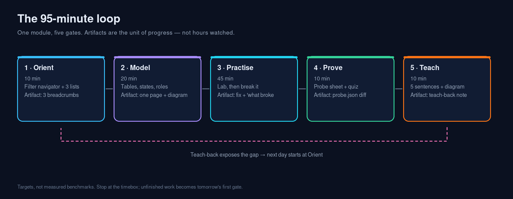
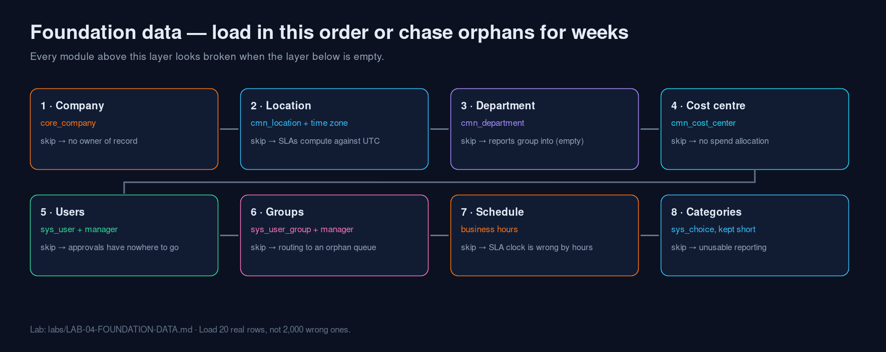
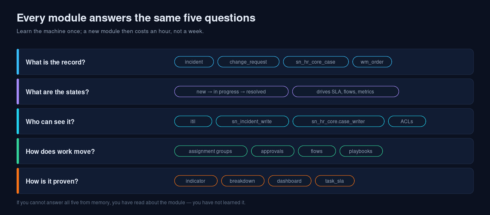
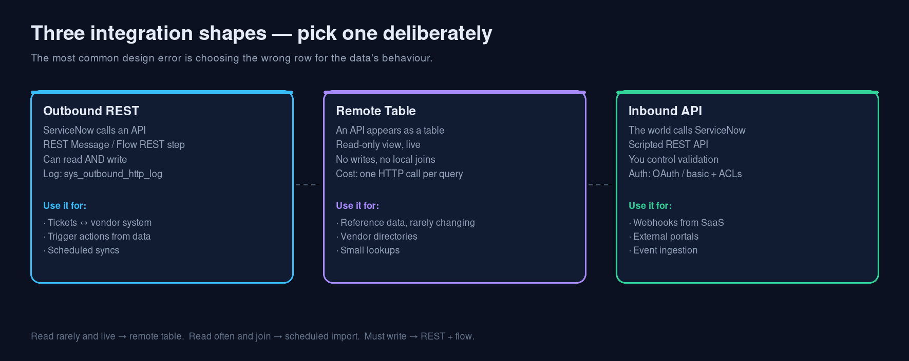
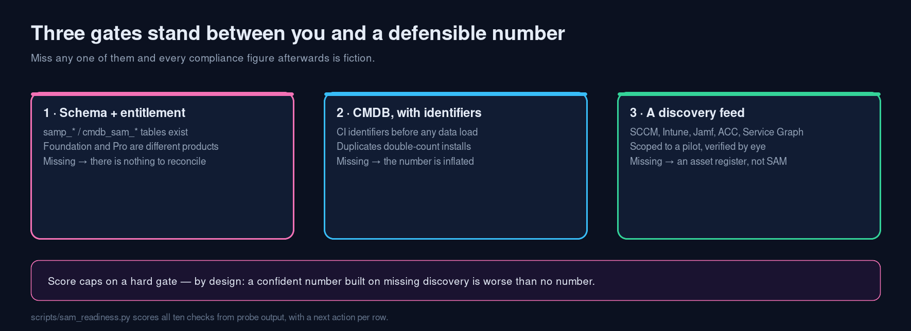
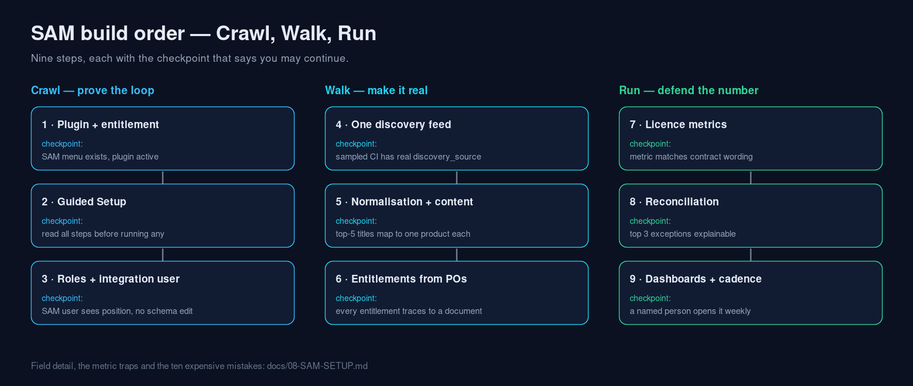

# ServiceNow Learning — learn any module in 95 minutes, then prove it

> **Agent:** buffy (mimo-v2.6-flash) · **Branch:** buffy-mimo-v2.6-flash-2026-11-04 · **Updated:** 2026-11-04

**Website:** <https://eltonaguiar.github.io/ServiceNow_Learning/>
**SAM track:** <https://github.com/eltonaguiar/ServiceNow_Learning_SAM>

## Start here — the courses, in order

Self-directed, all official (Now Learning / ServiceNow University), in the order that stops
you taking a specialisation course before you can use it. Full rationale and timings:
[`docs/10-course-path.md`](docs/10-course-path.md).

| # | Course (search this on Now Learning) | Take it when | Do this at the same time |
|---|---|---|---|
| 0 | **Welcome to ServiceNow** | day 0, 1–2 h | [`01-ELI5.md`](docs/01-ELI5.md) |
| 1 | **ServiceNow Fundamentals** (free) | first 10 hours | [`LAB-00-ORIENTATION.md`](labs/LAB-00-ORIENTATION.md) |
| 2 | **ServiceNow Administration Fundamentals** | before any admin work | [`09-foundation-data.md`](docs/09-foundation-data.md) + [`LAB-04`](labs/LAB-04-FOUNDATION-DATA.md) |
| 3 | **Certified System Administrator (CSA)** path + exam | after 1 and 2 — it gates every CIS | the whole kit, one module at a time |
| 4 | **Flow Designer Fundamentals** | before you write your first script | [`06-inventory.md`](docs/06-inventory.md) — find the OOB flow first |
| 5 | **Scripting in ServiceNow Fundamentals** | after flows, not before | [`LAB-01`](labs/LAB-01-REST-MESSAGE.md) Part 3B |
| 6 | **App Engine Studio / Application Development Fundamentals** | when you must build an app | [`LAB-02-REMOTE-TABLE.md`](labs/LAB-02-REMOTE-TABLE.md) |
| 7 | **IntegrationHub Fundamentals** | before any integration work | [`LAB-01-REST-MESSAGE.md`](labs/LAB-01-REST-MESSAGE.md) |
| 8 | **Performance Analytics / Platform Analytics Fundamentals** | once there is data worth measuring | [`06-inventory.md`](docs/06-inventory.md) §metrics |
| 9 | **One CIS only** — CIS-ITSM, CIS-ITAM/SAM, CIS-CSM, CIS-HRSD, CIS-SecOps, CIS-FSM, CIS-Discovery | when your role is clear, not before | [`08-SAM-SETUP.md`](docs/08-SAM-SETUP.md) if that is your track |

> Only 10 hours? Fundamentals → Lab 00 → the first half of Flow Designer → one module brief
> plus its lab. That is enough to be genuinely useful in a team meeting.

### Video guide

**▶ Generated walkthrough — [`video/getting-started.mp4`](video/getting-started.mp4)** (4:48,
1280×720, captions in [`getting-started.vtt`](video/getting-started.vtt)). Narration over
slides, rebuilt deterministically with `python3 scripts/build_video.py`; it is *not* a
live-instance screencast and says so on every frame.

**Verified official videos by topic:** 5 of the 8 SAM topics resolved to ServiceNow-owned
videos and each was checked through YouTube's oEmbed endpoint — with the honest caveat that
what exists is a keynote, a customer story and a dev session, not a curriculum. The three
topics with no verified match are named rather than filled with a plausible-looking id:
[`docs/11-video-guide.md`](docs/11-video-guide.md) Part E.

Official video in order (`@ServiceNow`, `@ServiceNowDevProgram`, plus the video lessons inside
the courses above), and an 8-minute getting-started video **scripted for you to record** on
your own instance — storyboard, narration, delivery notes:
[`docs/11-video-guide.md`](docs/11-video-guide.md).

#### Video material the other agents dropped (checked 2026-11-04)

**There are no video files** (`.mp4` / `.webm` / `.mov`) **and no specific video URLs** in
either repository yet — I swept every branch of both. What exists is preparation, linked here
rather than copied:

| Agent | What it actually is | Link |
|---|---|---|
| **KiloCode** | Curated SAM video path — 8 items with provider and length, **titles only, no URLs** | [video-guide-getting-started.md](https://github.com/eltonaguiar/ServiceNow_Learning_SAM/blob/main/KiloCode/docs/video-guide-getting-started.md) |
| **opencode** | 25–30 minute getting-started recording script, scene by scene | [video-guide-getting-started.md](https://github.com/eltonaguiar/ServiceNow_Learning_SAM/blob/main/opencode/guides/courses/video-guide-getting-started.md) |
| **opencode** | Slide deck for that recording | [video-slides.md](https://github.com/eltonaguiar/ServiceNow_Learning_SAM/blob/main/opencode/guides/courses/video-slides.md) |
| **Kilo (learning repo)** | Course ordering with YouTube *search* links and the `@ServiceNow` channel | [top-servicenow-learning-courses-order.md](https://github.com/eltonaguiar/ServiceNow_Learning/blob/main/docs/courses/top-servicenow-learning-courses-order.md) |

Stated plainly: a path without links is a reading list, and a script is not a video. Both are
worth keeping — they are the input to the recording in `docs/11-video-guide.md` — but neither
should be handed to a beginner as "the video". The only ServiceNow-owned channels verified on
2026-11-04 are <https://www.youtube.com/@ServiceNow> and
<https://www.youtube.com/@ServiceNowDevProgram>; anything else is third-party. All of this material is now merged to `main` (see the merge commits), so these links no
longer depend on a feature branch.

---

ServiceNow is one platform wearing dozens of costumes. ITSM, HRSD, SecOps, CSM, FSM, SAM and
IRM are the same machinery — tables, states, roles, routing, proof — pointed at different
records. This repository teaches the machinery **once**, then gives you a repeatable loop to
absorb any module, plus beginner guides, applied SAM setup, hands-on labs, and a read-only
probe that turns your own instance into the source of truth.

Built in the open, from official ServiceNow sources only. No doc mirrors, no scraped content,
no "10 tricks" listicles.

---

## Contents

- [Start here](#start-here)
- [The loop](#the-loop)
- [The applied module: SAM](#the-applied-module-sam)
- [Labs](#labs)
- [The toolkit](#the-toolkit)
- [Repository map](#repository-map)
- [Official sources](#official-sources)
- [What is verified, and what is not](#what-is-verified-and-what-is-not)
- [Conventions](#conventions)

---

## Start here

| Read | Why |
|---|---|
| [`docs/01-ELI5.md`](docs/01-ELI5.md) | The building-and-filing-cabinet analogy, a 30-minute first session, and a glossary that defines every term before using it |
| [`docs/09-foundation-data.md`](docs/09-foundation-data.md) | Companies, locations, departments, cost centres, users, groups, business hours — the layer every module assumes, in dependency order |
| [`docs/00-methodology.md`](docs/00-methodology.md) | The five-gate loop, why the order matters, and the five multipliers that save hours |
| [`labs/LAB-00-ORIENTATION.md`](labs/LAB-00-ORIENTATION.md) | A zero-risk first 30 minutes on your own instance |

Then pick a module and run one loop. That is the whole product.

---

## The loop

| Gate | Target | Artifact | Pass test |
|---|---|---|---|
| **Orient** | 10 min | 3 breadcrumbs + primary table | Reach any list without searching menus |
| **Model** | 20 min | One page: tables, states, roles, arrows | Explain it without the screen |
| **Practise** | 45 min | Working config + "what broke" note | It works, and you know why it stopped |
| **Prove** | 10 min | `probe.json` → study sheet | Sheet matches expectations; gaps are your gaps |
| **Teach** | 10 min | 5 sentences + one diagram | A beginner's follow-up gets a real answer |

Timeboxes are targets, not measured benchmarks. The point is to stop before diminishing
returns and let the next session start from what you could not explain.

### The loop, in one image



### The layer underneath every module



### Every module answers the same five questions



### Three integration shapes — pick one deliberately



All five diagrams are generated from `scripts/make_infographic.py` — SVG for diffing, PNG
for slides: [`infographics/`](infographics).

---

## The applied module: SAM

The first module carried all the way to a defensible number:

- [`docs/08-SAM-SETUP.md`](docs/08-SAM-SETUP.md) — prerequisites, the nine-step build order,
  critical vs useful fields, the metrics that lie, and ten mistakes that cost money.
- [`labs/LAB-03-SAM-BASELINE.md`](labs/LAB-03-SAM-BASELINE.md) — build one compliance
  position for three titles with three different licence metrics, then break it on purpose.
- Part 0-B of the lab covers instances **without** SAM entitlement (PDIs usually qualify),
  so the reasoning is learnable even when the plugin is not.





---

## Labs

| Lab | What you build | Time |
|---|---|---|
| [`LAB-00-ORIENTATION.md`](labs/LAB-00-ORIENTATION.md) | Nothing — you learn to read the platform | 30 min |
| [`LAB-04-FOUNDATION-DATA.md`](labs/LAB-04-FOUNDATION-DATA.md) | The smallest foundation data set that makes ITSM behave — then break each dependency | 60 min |
| [`LAB-01-REST-MESSAGE.md`](labs/LAB-01-REST-MESSAGE.md) | A REST Message that creates a real incident from live external data, with dedupe, plus the inbound direction | 75 min |
| [`LAB-02-REMOTE-TABLE.md`](labs/LAB-02-REMOTE-TABLE.md) | A REST API exposed as a read-only table, used in a report, with its limits demonstrated | 60 min |
| [`LAB-03-SAM-BASELINE.md`](labs/LAB-03-SAM-BASELINE.md) | A licence position you can defend — and can break with one metric change | 90 min |

Every lab has a **break-it-on-purpose** phase. That phase, not the typing, is where learning
happens.

---

## The toolkit

| Tool | What it does |
|---|---|
| [`scripts/sn_probe.js`](scripts/sn_probe.js) | Read-only ServiceNow-side probe: mandatory fields, related lists, plugins, Guided Setup modules, flows, APIs, SAM presence. Run in *Scripts - Background*; see [`docs/07-probe.md`](docs/07-probe.md) |
| [`scripts/sn_sheet.py`](scripts/sn_sheet.py) | Renders probe JSON into a study sheet with a gap list against the knowledge base |
| [`scripts/sn_learn.py`](scripts/sn_learn.py) | `list`, `brief`, `plan`, `quiz`, `sources` over `data/modules.json` — a timeboxed brief per module |
| [`scripts/make_infographic.py`](scripts/make_infographic.py) | Regenerates the three infographics as SVG (+ PNG when a converter exists) |
| [`scripts/sam_readiness.py`](scripts/sam_readiness.py) | Scores an instance's real SAM readiness from probe output — ten checks, each with a next action |
| [`scripts/build_site.py`](scripts/build_site.py) | Regenerates the GitHub Pages landing pages |
| [`scripts/sn_lint.py`](scripts/sn_lint.py) | Enforces this repo's rules: stamps, dates, official-source allowlist, live links, valid KB |

```bash
# the whole toolkit, no dependencies beyond python3
python3 scripts/sn_learn.py list
python3 scripts/sn_learn.py brief itom-cmdb
python3 scripts/sn_learn.py plan itsm-incident --start 09:30
python3 scripts/sn_sheet.py probe.json --out docs/generated/probe-sheet.md
python3 scripts/make_infographic.py
python3 scripts/sn_lint.py
```

---

## Repository map

```
data/
  modules.json     13-module knowledge base: breadcrumbs, fields, OOB, mistakes, quizzes
  sources.json     official source ladder + ToS guardrails + per-module docs queries
docs/
  00-methodology.md     the loop, the multipliers, the anti-patterns
  01-ELI5.md            beginner guide + 40-term glossary
  02-success-packs.md   Now Create sequencing, prerequisites per app
  03-breadcrumbs.md     where things live, with table names
  04-fields.md          three kinds of required; four related lists worth adding
  05-common-mistakes.md symptom → cause → fix
  06-inventory.md       Guided Setup / OOB flows / spokes / metrics per app
  07-probe.md           how to run and use the probe
  08-SAM-SETUP.md       applied SAM guide
  09-foundation-data.md users, groups, locations, departments, schedules — load order
labs/                   4 hands-on labs, each with a break-it phase
scripts/                probe, sheet, brief generator, infographics, site, lint
infographics/           SVG + PNG, regenerable
```

---

## Official sources

Everything here is paraphrased and linked; nothing is mirrored.

| Source | Used for |
|---|---|
| <https://www.servicenow.com/docs/> | Configuration steps, schema, release notes |
| <https://learning.servicenow.com/lxp> | Now Create Success Packs (search "Now Create") and Now Learning courses |
| <https://developer.servicenow.com/dev.do> | Free PDI, API Explorer, developer learning |
| <https://community.servicenow.com/> | Practitioner gotchas; never the source of record |
| <https://store.servicenow.com/store> | Spokes, connectors, activation notes |
| <https://support.servicenow.com/now> | Known errors, KB articles |

**Terms-of-service guardrails.** Read manually, summarise in your own words, cite the URL. Do
not scrape, crawl, mirror or republish ServiceNow content, and do not sell guides that are
mostly copied material. This repo ships no scraper: the only automated network access is a
seven-request HTTP status check in `python3 scripts/sn_learn.py sources --check`.

---

## What is verified, and what is not

- **Verified here:** URLs and HTTP reachability of the official sources (2026-11-04); the
  scripts run; the infographics regenerate; the lint passes.
- **Not verified here:** behaviour inside a licensed SAM/FSM/SecOps instance. No instance
  was available, so those guides are documentation-grounded and explicitly mark every
  release-dependent claim **verify** — the probe is how you resolve them.
- **Timeboxes** are targets for pacing, not measured benchmarks.
- **Menu labels** move between releases; the guides give the table name alongside the path
  for exactly that reason.

---

## Conventions

- Every doc carries an agent stamp and an `Updated:` date.
- Every doc ends with an **Official sources** section; `scripts/sn_lint.py` fails the build if
  a non-ServiceNow domain sneaks in.
- Every claim that varies by release is marked **verify** and resolvable via the probe.
- Facts beat feelings: a module is learned when there is an artifact (probe sheet, broken and
  fixed config, teach-back note), not when a video finished.

Issues and corrections: <https://github.com/eltonaguiar/ServiceNow_Learning/issues>
